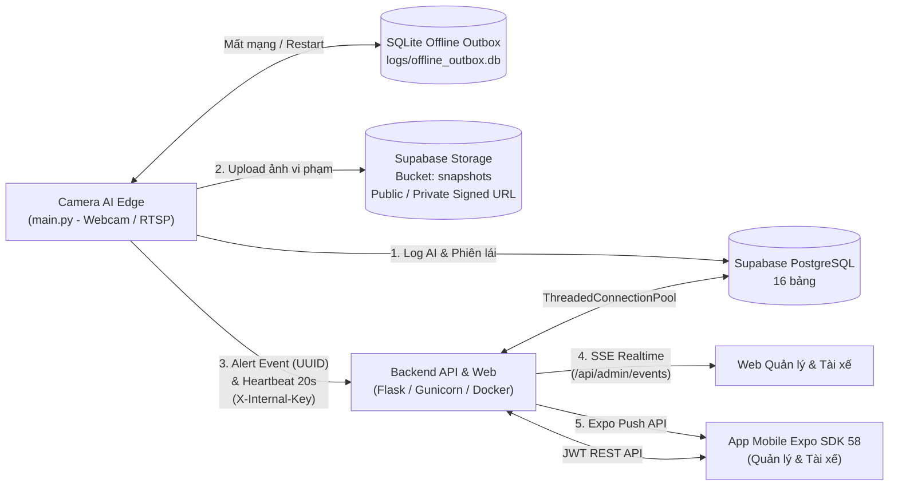

# TÀI LIỆU CHI TIẾT DỰ ÁN DACN1

> **Tên đề tài:** Hệ thống Giám sát Tài xế, Xác thực Khuôn mặt 128D & Cảnh báo Buồn ngủ bằng Trí tuệ Nhân tạo (AI)  
> **Mã dự án:** `DACN1`  
> **Kho mã nguồn:** `https://github.com/Nganphan1514/DACN1.git` (`main`)  
> **Nền tảng:** Camera AI Edge (Python/Windows/RTSP) + Backend & Web (Flask/Gunicorn/Docker) + Ứng dụng Di động (Expo React Native SDK 58) + Cloud Database & Storage (Supabase PostgreSQL & Storage)

---

## 1. Tổng quan & Mục tiêu đề tài

### 1.1. Bài toán thực tế
Tai nạn giao thông đường dài phần lớn xuất phát từ tình trạng **tài xế ngủ gật, mệt mỏi kéo dài, mất tập trung** hoặc **người không được phân công tự ý điều khiển phương tiện**. Các giải pháp truyền thống chỉ dừng lại ở mức cảnh báo rời rạc trên cabin, thiếu khả năng:
- Xác thực chính xác danh tính tài xế theo đúng xe/ca chạy được phân công.
- Đồng bộ cảnh báo tức thời về trung tâm điều hành và điện thoại quản lý.
- Theo dõi vòng đời xử lý cảnh báo, sức khỏe thiết bị camera và duy trì dữ liệu khi xe đi qua vùng mất sóng 4G/5G.

### 1.2. Mục tiêu của hệ thống DACN1
1. **Giám sát thông minh thời gian thực tại biên (Edge AI)**: Phát hiện sớm 4 trạng thái (`TINH TAO`, `MAT TAP TRUNG`, `MET MOI`, `BUON NGU`) kết hợp 6 tín hiệu hành vi và mô hình học máy SVM 3 lớp, đi kèm hiệu chuẩn mắt cá nhân (`EyeCalibration`) giảm báo sai cho người mắt nhỏ.
2. **Xác thực sinh trắc học khuôn mặt 128 chiều**: Đối chiếu đúng người – đúng xe phân công; chỉ Quản lý mới có quyền đăng ký / đăng ký lại khuôn mặt và quét QR CCCD tạo tài khoản tài xế.
3. **Vận hành khép kín & Bền vững khi mất mạng**: Có vòng đời xử lý cảnh báo (`MOI → DA_TIEP_NHAN → DANG_XU_LY → DA_DONG / CANH_BAO_SAI`), giám sát nhịp tim camera 3 mức (`ONLINE_HEALTHY / ONLINE_DEGRADED / OFFLINE`) và hàng đợi SQLite Offline Outbox chống mất dữ liệu.
4. **Đa nền tảng Web + Mobile + Cloud**: Quản lý và tài xế theo dõi mọi lúc mọi nơi qua Web Dashboard (SSE Realtime), App Expo (Push Notification + AI Cam dự phòng) và lưu trữ tập trung trên Supabase.

---

## 2. Công nghệ & Kiến trúc hệ thống

### 2.1. Tech Stack

| Tầng hệ thống | Công nghệ sử dụng | Vai trò chính |
| :--- | :--- | :--- |
| **Computer Vision & AI** | Python 3.11, OpenCV (`CAP_DSHOW`/`CAP_FFMPEG`), MediaPipe Face Mesh, `dlib-bin` + `face_recognition_models`, scikit-learn (`SVC`, `GroupKFold`, `StandardScaler`), NumPy, Pandas | Trích xuất landmark mắt/miệng/tư thế đầu, Face Embedding 128D, phân loại trạng thái buồn ngủ |
| **Cảnh báo & Thiết bị biên** | `gTTS`, `pygame.mixer`, `pyttsx3` (offline fallback), `sqlite3` (Offline Outbox), OpenStreetMap Nominatim | Cảnh báo giọng nói không nghẽn FPS, gợi ý điểm dừng nghỉ gần nhất, lưu đệm bền vững khi mất mạng |
| **Backend & Web** | Flask, Flask-JWT-Extended, `bcrypt`, `psycopg2` (`ThreadedConnectionPool`), Gunicorn (`gevent`, `--worker-connections 1000`), Server-Sent Events (SSE), Tailwind CSS, ReportLab | REST API, Web Admin/Driver, xác thực kép JWT/Session, đẩy cảnh báo realtime không nghẽn thread, xuất báo cáo PDF tiếng Việt |
| **Mobile App** | React Native, **Expo SDK 58**, `expo-camera` (chụp ảnh & quét QR CCCD), `expo-notifications` (Expo Push API), `expo-speech`, `expo-haptics`, AsyncStorage | App Quản lý (quét CCCD, đăng ký khuôn mặt 128D, nhận Push) & App Tài xế (lịch chạy, AI Cam dự phòng) |
| **Database & Cloud** | **Supabase PostgreSQL (16 bảng)**, **Supabase Storage** (Public & Private Signed URL) | Lưu trữ dữ liệu chuẩn hóa, vector 128D, ảnh vi phạm tập trung trên Cloud |
| **Kiểm thử & DevOps** | `pytest` (23 tests), Docker (`Dockerfile`, `docker-compose.yml`), EAS Build (`mobile/eas.json`) | Kiểm thử tự động, đóng gói triển khai VPS 24/7, build `.apk`/`.aab` |

### 2.2. Sơ đồ kiến trúc tổng thể



---

## 3. Cấu trúc thư mục dự án

```text
DACN1/
├── main.py                         # Luồng chính Camera AI Edge (Webcam/RTSP, HUD, Outbox, Heartbeat)
├── ai/
│   ├── collect_dataset.py          # Thu thập dữ liệu 5 đặc trưng + SessionId (v2)
│   └── train_model.py              # Huấn luyện SVM balanced + GroupKFold chống Data Leakage
├── alerts/
│   ├── snapshot.py                 # Lưu ảnh chụp vi phạm
│   ├── voice_alert.py              # Worker phát giọng nói (cache MP3 + fallback pyttsx3)
│   └── smart_voice.py              # Kịch bản cảnh báo tiếng Việt theo tình huống
├── backend/
│   ├── app.py                      # Khởi tạo Flask App, JWT, Blueprints, /privacy
│   ├── middleware/auth_guard.py    # Xác thực JWT/Session, RBAC, chống IDOR, thu hồi tài khoản bị khóa
│   ├── routes/
│   │   ├── auth_routes.py          # Đăng nhập / Đăng xuất (bcrypt + auto-upgrade)
│   │   ├── admin_routes.py         # Trang & API Quản lý (Dashboard, Drivers, Vehicles, Scheduler, Alerts, Devices, PDF)
│   │   ├── driver_routes.py        # Trang & API Tài xế (Dashboard, Schedules, Violations, History, Notes, Reports, Profile)
│   │   ├── face_routes.py          # Đăng ký / kiểm tra khuôn mặt 128D (chỉ quan_ly)
│   │   ├── ai_monitor_routes.py    # API phân tích frame cho AI Cam dự phòng trên điện thoại
│   │   └── realtime_routes.py      # Internal Alert/Heartbeat, SSE /api/admin/events, Expo Push Token, /api/snapshots
│   └── templates/                  # Giao diện Web (auth/, admin/, driver/, privacy.html)
├── config/
│   ├── ai_config.py                # Ngưỡng AI, EAR/MAR/PERCLOS/Pitch/Yaw, CAMERA_SOURCE
│   ├── app_config.py               # Cấu hình Flask, JWT, Supabase URL/Key/Private Bucket, Internal Key
│   ├── vehicle_config.py           # VEHICLE_ID, VEHICLE_NAME cho thiết bị biên
│   └── logger.py                   # Logging chuẩn hóa
├── core/
│   ├── drowsiness_analyzer.py      # Bộ phân tích 4 trạng thái & Fatigue Score 0–100% + hysteresis
│   ├── hud_renderer.py             # Vẽ giao diện HUD trực quan lên khung hình camera
│   └── ops_rules.py                # Quy tắc thuần (Alert State Machine, Device Health 3 mức, che CCCD/GPLX)
├── database/
│   ├── schema_postgres.sql         # Schema đầy đủ 16 bảng + index + cột P0/P0+ cho Supabase
│   ├── seed_data_postgres.sql      # Dữ liệu mẫu khởi tạo
│   └── mysql_service.py            # Lớp truy vấn PostgreSQL (ThreadedConnectionPool) & toàn bộ nghiệp vụ DB
├── detection/
│   ├── mediapipe_detector.py       # MediaPipe Face Mesh trích xuất EAR, MAR, landmark
│   ├── eye_calibration.py          # Hiệu chuẩn mắt cá nhân 3 giây đầu
│   ├── head_pose.py                # Ước lượng góc đầu Pitch & Yaw
│   └── predictor.py                # Nạp model SVM + tự tương thích 2 hoặc 5 đặc trưng qua model_meta.json
├── face_auth/
│   ├── embedding_service.py        # Trích xuất & so khớp Face Embedding 128D (dlib)
│   └── recognize_driver.py         # Xác thực tài xế (128D cache 60s -> fallback LBPH)
├── mobile/                         # Ứng dụng di động Expo SDK 58
│   ├── App.js                      # Điều hướng vai trò Quản lý (5 tab) & Tài xế (7 tab)
│   ├── eas.json                    # Cấu hình build Android (.apk / .aab)
│   └── src/screens/                # Login, Dashboard, AdminDrivers (QR CCCD), FaceRegister, Monitor (AI Cam), ...
├── services/
│   ├── offline_outbox.py           # Hàng đợi SQLite bền vững + Dead-letter (logs/offline_outbox.db)
│   ├── realtime_client.py          # Gửi Alert (Event Contract) & Device Heartbeat về Backend
│   ├── storage_service.py          # Upload Supabase Storage & tạo Signed URL cho Private Bucket
│   ├── expo_push_service.py        # Gửi Push Notification qua Expo Push API
│   └── location_service.py         # Tìm điểm dừng nghỉ gần nhất (bất đồng bộ + cache 10 phút)
├── tests/                          # Bộ 23 unit tests (pytest)
├── docs/                           # Tài liệu hệ thống & đặc tả dự án
├── Dockerfile & docker-compose.yml # Đóng gói chạy Backend 24/7
└── run_web.bat / run_expo.bat      # Script chạy nhanh trên Windows
```

---

## 4. Chi tiết các phân hệ chính

### 4.1. Phân hệ Camera AI Edge (`main.py`)
- **Hiệu chuẩn mắt cá nhân (3 giây — chống ngoại lai)**: Khi bắt được khuôn mặt, tính baseline `EAR` bằng **phân vị 75%** (loại bỏ frame chớp mắt/nheo mắt) và kẹp biên độ scale trong `0.75x – 1.50x`, vừa giảm báo sai cho người mắt nhỏ vừa chống nheo mắt đầu ca làm hỏng ngưỡng.
- **Tăng sáng thích nghi ban đêm (CLAHE)**: Tự động áp dụng CLAHE trên kênh độ sáng LAB khi độ sáng trung bình khung hình thấp (`< 65`), cải thiện độ ổn định landmark MediaPipe trong khung giờ `0h–5h`.
- **Xác thực khuôn mặt 128D & Khóa phiên**:
  - Quét trong 3 giây, kiểm tra mỗi 0.7 giây, yêu cầu khớp ≥ 2 lần với khoảng cách Euclidean `< 0.48` (tự làm mới cache từ Supabase mỗi 60 giây; fallback LBPH nếu chưa có vector 128D).
  - Đối chiếu phân công xe: **Đúng người & đúng xe** → mở/nối `phien_lai_xe` (tự gắn `lich_chay_id`); **Sai xe** hoặc **Người lạ** → cảnh báo giọng nói + chụp ảnh + upload Storage + gửi sự kiện `SAI_XE`/`NGUOI_LA`.
  - Mất mặt liên tục **3 phút** khi xe đang chạy → bắn cảnh báo sớm **`CHE_CAMERA`** về trung tâm quản lý; mất mặt > 30 phút mới tự đóng phiên và ghi rõ `ly_do_ket_thuc = 'AUTO_MAT_DAU_30P'`.
- **Phân tích đa yếu tố (`DrowsinessAnalyzer`)**:
  - Kết hợp: nhắm mắt kéo dài (`EAR < 0.20` ≥ 1.2s & ≥ 25 frame), `PERCLOS > 45%`, tần suất chớp mắt (`≥ 26 lần/phút`), tần suất ngáp (`MAR > 0.65` ≥ 0.8s, ≥ 2 lần/3 phút), `Pitch > 15°` (gục đầu), `|Yaw| > 25°` (nhìn lệch đường ≥ 2.5s), khung giờ nguy hiểm (0h–5h, 13h–15h), lái liên tục > 2h và xác suất 3 lớp từ SVM.
  - Xuất **4 trạng thái** (`TINH TAO`, `MAT TAP TRUNG`, `MET MOI`, `BUON NGU`) + điểm **Fatigue Score 0–100%** có cơ chế hồi phục dần (hysteresis).
- **Chống lag, Offline Outbox & Heartbeat**:
  - Toàn bộ ghi DB, upload ảnh, gửi cảnh báo, gửi heartbeat chạy ở worker nền `_db_queue` và âm thanh chạy ở worker riêng để giữ FPS mượt.
  - **SQLite Offline Outbox (`logs/offline_outbox.db`, giới hạn `max_rows = 5.000` FIFO)**: Mọi sự kiện gửi lỗi tạm thời (`5xx`/mạng) đều lưu xuống đĩa kèm **Event Contract** (`event_id` UUID, `payload_version`, `device_id`, `occurred_at` UTC), tự đồng bộ lại mỗi 15 giây (25 sự kiện/đợt); lỗi vĩnh viễn (`400`/`422` hoặc vượt 20 lần thử) chuyển trạng thái `DEAD_LETTER`; tự dọn FIFO chống tràn đĩa.
  - **Device Heartbeat (20 giây)**: Gửi `device_id`, `xe_id`, `fps`, `camera_ok`, `active_driver_id`, `active_phien_id`, `outbox_pending`, `dead_letter_count` về Backend.

### 4.2. Phân hệ Thu thập & Huấn luyện AI (`ai/`)
- `ai/collect_dataset.py`: Ghi tự động ~6–7 mẫu sạch/giây gồm `EAR (norm)`, `MAR`, `Pitch`, `Yaw`, `PERCLOS`, `Label` (`0/1/2`) và **`SessionId`** (tự tạo mới khi bấm `R` đổi người/phiên).
- `ai/train_model.py`: Tự lọc nhiễu rõ rệt, huấn luyện `SVC(kernel="rbf", C=10, probability=True, class_weight="balanced")`. Khi có ≥ 2 `SessionId`, sử dụng **`GroupShuffleSplit` + `GroupKFold` trong `Pipeline(StandardScaler, SVC)`** để chống rò rỉ dữ liệu frame giữa train/test (anti-Data Leakage), xuất Classification Report & Confusion Matrix, lưu `model/model_meta.json`.

### 4.3. Phân hệ Nghiệp vụ, Vòng đời Cảnh báo & Bảo mật
- **Chống trùng lịch & phiên**:
  - `kiem_tra_trung_lich_chay()` chạy trên cả tạo mới và cập nhật lịch, chặn trùng khung giờ của cùng tài xế hoặc cùng xe.
  - `tao_phien_lai_xe()` kết hợp partial unique index `uq_phien_lai_xe_tai_xe_dang_mo` trên PostgreSQL đảm bảo mỗi tài xế chỉ có tối đa 1 phiên đang mở.
- **Vòng đời Cảnh báo (Alert Lifecycle)**:
  - Trạng thái: `MOI → DA_TIEP_NHAN → DANG_XU_LY → DA_DONG / CANH_BAO_SAI`.
  - Backend khử trùng bằng `ON CONFLICT (event_id) DO NOTHING` (chỉ phát SSE & Push cho sự kiện mới).
  - Hỗ trợ **Optimistic Locking** (`expected_status` → trả `409 Conflict` nếu có quản lý khác đã cập nhật trước) và chặn ghi đè cảnh báo đã đóng; ghi audit vào `lich_su_thao_tac`.
- **Bảo mật & Quyền riêng tư**:
  - Mật khẩu hash `bcrypt` (tự động nâng cấp mật khẩu cũ khi đăng nhập).
  - **Thu hồi JWT & Session tức thì**: `auth_guard.py` kiểm tra trạng thái tài khoản (cache TTL 20s + `invalidate_account_cache()`), tự xóa session và chặn `401` ngay khi tài khoản bị khóa.
  - **Phân quyền chặt**: Chỉ `quan_ly` được truy cập `/admin/*`, tạo tài khoản tài xế, quét CCCD và đăng ký/đổi khuôn mặt 128D. Tài xế bị khóa IDOR qua `resolve_driver_id()`.
  - **Che CCCD/GPLX & bảo vệ ảnh**: Trả `so_gplx_masked` (`079******345`), `/api/snapshots/<filename>` kiểm tra quyền sở hữu (`403` nếu truy cập chéo), và hỗ trợ **Supabase Private Bucket Signed URL** (`SUPABASE_BUCKET_PRIVATE=true`).

### 4.4. Phân hệ Web & Ứng dụng Di động
- **Web Quản lý (`/admin/*`)**: Dashboard tổng quan (auto-refresh 5s + SSE toast realtime), bảng **Trạng thái Thiết bị Camera** (🟢 `ONLINE_HEALTHY` / 🟡 `ONLINE_DEGRADED` / 🔴 `OFFLINE`), bảng **Quản lý Vòng đời Cảnh báo** (lọc + bấm 1 chạm `Tiếp nhận`/`Đã đóng`/`Báo sai`), Thư viện ảnh vi phạm, Quản lý Tài xế, Xe, Lịch chạy, Báo cáo sự cố, Thống kê & **Xuất PDF tiếng Việt**.
- **Web Tài xế (`/driver/*`)**: Dashboard cabin, Lịch chạy, Lịch sử vi phạm, Lịch sử phiên lái, Thông báo, Gửi báo cáo sự cố, Hồ sơ cá nhân.
- **App Mobile Expo SDK 58 (`mobile/`)**:
  - **Quản lý (5 tab)**: Cabin, Tài xế (**quét mã QR CCCD gắn chip Việt Nam** tự điền thông tin + đăng ký/đăng ký lại khuôn mặt 128D), Lịch chạy, Sự cố, Cá nhân + nhận **Expo Push Notifications** rung & chuông.
  - **Tài xế (7 tab)**: Cabin, **AI Cam dự phòng (`MonitorScreen`)** (gửi frame về `/api/ai/analyze-frame`, hiện Fatigue 0–100%, rung + cảnh báo giọng nói tiếng Việt `expo-speech`), Lịch, Vi phạm, Thông báo, Sự cố, Cá nhân.

---

## 5. Thiết kế Cơ sở dữ liệu Supabase (16 bảng + Storage)

File schema đầy đủ: `database/schema_postgres.sql` (toàn bộ có `IF NOT EXISTS`, chạy an toàn trên Supabase SQL Editor).

| STT | Tên bảng | Mô tả vai trò |
| :-: | :--- | :--- |
| 1 | `tai_khoan` | Tài khoản đăng nhập (`quan_ly`/`tai_xe`), mật khẩu `bcrypt`, trạng thái `hoat_dong`/`khoa` |
| 2 | `tai_xe` | Hồ sơ tài xế (họ tên, SĐT, GPLX/CCCD unique, địa chỉ, trạng thái) |
| 3 | `xe` | Phương tiện (biển số unique, model, loại xe, `tai_xe_mac_dinh_id`, trạng thái) |
| 4 | `lich_chay` | Lịch phân công chuyến đi (chặn trùng ca tài xế/xe) |
| 5 | `phien_lai_xe` | Phiên lái thực tế (`ly_do_ket_thuc`, partial unique index chống trùng phiên mở) |
| 6 | `nhat_ky_phat_hien` | Nhật ký chỉ số AI (`ear`, `mar`, `risk_score`, `trang_thai`) |
| 7 | `anh_canh_bao` | URL ảnh chụp cảnh báo buồn ngủ |
| 8 | `nguoi_la` | Ảnh chụp & ghi chú khi phát hiện người lạ hoặc tài xế sai xe |
| 9 | `ghi_chu` | Thông báo từ quản lý gửi tài xế (`da_doc`) |
| 10 | `bao_cao_su_co` | Báo cáo sự cố từ tài xế & phản hồi quản lý |
| 11 | `lich_su_thao_tac` | Audit log mọi thao tác quản trị & xử lý cảnh báo |
| 12 | `du_lieu_khuon_mat` | Vector sinh trắc học khuôn mặt 128D (JSON) |
| 13 | `anh_khuon_mat` | Bản sao nhị phân ảnh khuôn mặt đăng ký (`BYTEA`) |
| 14 | `thiet_bi_thong_bao` | Lưu `expo_push_token` theo tài khoản & vai trò |
| 15 | `su_kien_canh_bao` | Vòng đời cảnh báo (`event_id` UUID unique, `device_id`, `occurred_at`, trạng thái, người xử lý) |
| 16 | `thiet_bi_camera` | Thiết bị camera biên & Heartbeat (`device_id` unique, `fps`, `outbox_pending`, `dead_letter_count`) |

* **Supabase Storage**: Bucket `snapshots` lưu toàn bộ ảnh vi phạm (hỗ trợ Public URL hoặc Private Signed URL có thời hạn).

---

## 6. Danh sách API chính

| Nhóm | Endpoint tiêu biểu | Quyền truy cập |
| :--- | :--- | :--- |
| **Xác thực** | `POST /api/login`, `POST /api/logout`, `GET /api/me` | Công khai / Đã đăng nhập |
| **Quản trị** | `GET /api/admin/dashboard`, `GET/POST/PUT /api/admin/drivers`, `/api/admin/vehicles`, `/api/admin/schedules`, `/api/admin/reports`, `GET /api/admin/snapshots`, `GET /api/admin/export-pdf` | `quan_ly` |
| **Cảnh báo & Thiết bị** | `GET /api/admin/alerts`, `PUT /api/admin/alerts/<id>`, `GET /api/admin/devices`, `GET /api/admin/events` (SSE) | `quan_ly` |
| **Khuôn mặt 128D** | `POST /api/face/register`, `GET /api/face/status` | `quan_ly` (đăng ký) / Đã đăng nhập (xem trạng thái) |
| **Tài xế & AI Cam** | `GET /api/driver/dashboard`, `/schedules`, `/violations`, `/history`, `/notifications`, `POST /api/driver/reports`, `POST /api/ai/analyze-frame` | `tai_xe` (chống IDOR) / `quan_ly` |
| **Nội bộ (Edge)** | `POST /api/internal/alert-event`, `POST /api/internal/device-heartbeat` | `X-Internal-Key` |
| **Push & Ảnh** | `POST /api/push/register-token`, `GET /api/snapshots/<filename>` | Đã đăng nhập (kiểm tra quyền sở hữu ảnh) |

---

## 7. Kiểm thử tự động & Triển khai

### 7.1. Bộ kiểm thử tự động (`pytest -v` — 26 tests)
- `tests/test_detection.py` (9 tests): EAR, MAR, EyeCalibration, 4 trạng thái `DrowsinessAnalyzer`, ngáp liên tục, hồi phục Fatigue Score, xác suất 3 lớp SVM.
- `tests/test_auth_and_security.py` (4 tests): `bcrypt` hash/verify & auto-upgrade, so khớp Face 128D, chặn `401` API quản trị & internal alert.
- `tests/test_storage.py` (3 tests): Chuẩn hóa URL, fallback local, upload Supabase Storage.
- `tests/test_expo_push.py` (2 tests): Định dạng Expo Push Token & gửi batch thông báo.
- `tests/test_p0_upgrades.py` (8 tests): `OfflineOutbox` bền vững/retry/chống trùng `event_id`/`DEAD_LETTER`/FIFO cap `max_rows`, Event Contract & mã trạng thái `realtime_client`, Private Bucket Signed URL, thu hồi tài khoản bị khóa + xóa cache, Alert State Machine + Device Health 3 mức + che CCCD/GPLX, `EyeCalibration` p75 + scale clamp, và tăng sáng ban đêm CLAHE.

### 7.2. Hướng dẫn chạy nhanh
```powershell
# 1. Chạy Backend Web & API
.\venv\Scripts\python.exe backend\app.py

# 2. Chạy Camera AI Edge (Webcam / RTSP)
.\venv\Scripts\python.exe main.py

# 3. Chạy App Mobile (Expo SDK 58)
cd mobile
npx expo start

# 4. Chạy bộ kiểm thử tự động
.\venv\Scripts\python.exe -m pytest -v

# 5. Triển khai VPS bằng Docker
docker compose up -d --build
```
