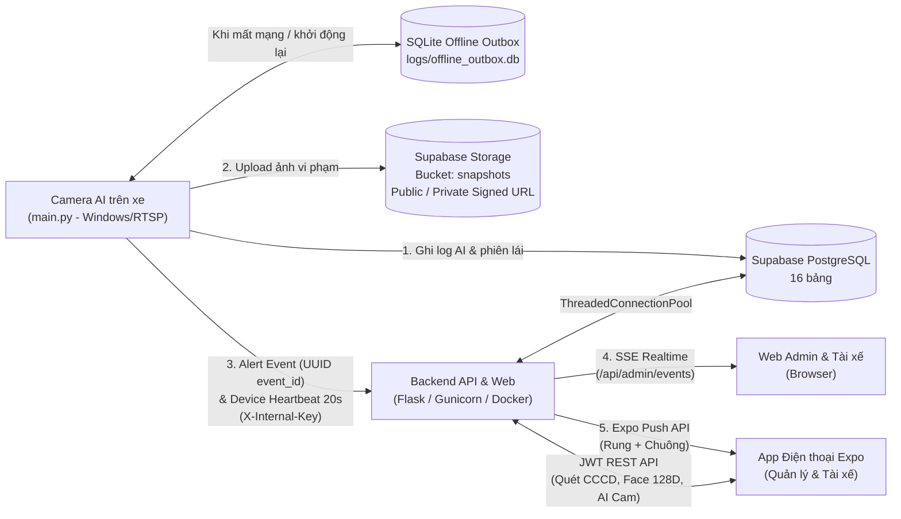
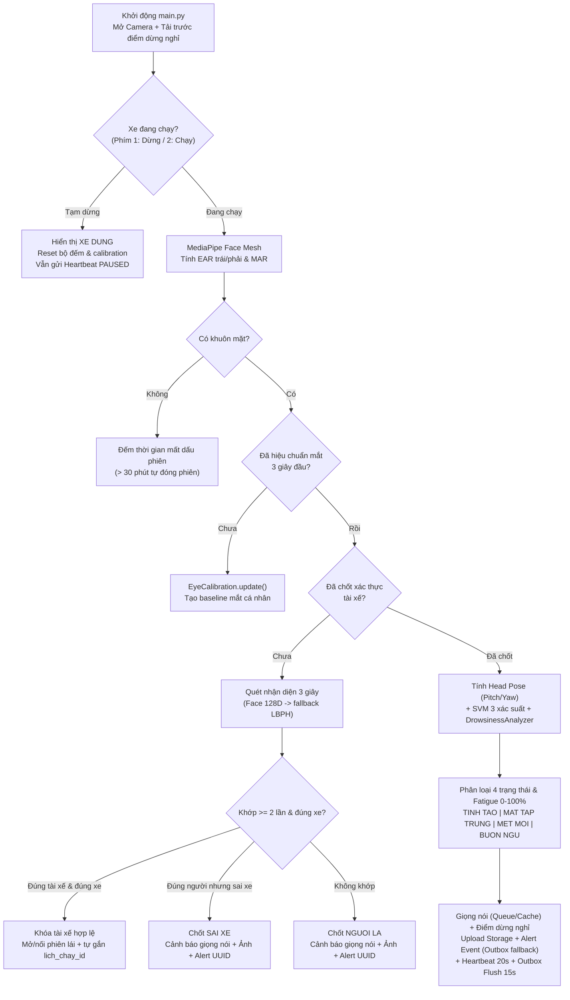

# TÀI LIỆU RÀ SOÁT LOGIC HOẠT ĐỘNG & CHỨC NĂNG HỆ THỐNG DACN1

> **Hệ thống Giám sát Tài xế, Xác thực Khuôn mặt 128D & Cảnh báo Buồn ngủ bằng AI**
> Kiến trúc đa nền tảng: **Camera AI Edge (Windows/RTSP + SQLite Outbox) + Backend API & Web (Flask/Docker) + App Di động (Expo SDK 58) + Supabase (PostgreSQL 16 bảng & Storage)**.
> *Phiên bản cập nhật sau khi hoàn thiện trọn bộ 5 hạng mục nâng cấp cốt lõi (P0-1 → P0-5).*

---

## 1. Kiến trúc tổng thể hệ thống



### 4 thành phần cốt lõi
1. **Luồng Camera AI Edge (`main.py`)**: Chạy trên máy tính Windows hoặc thiết bị biên gắn cabin xe, hỗ trợ **Webcam USB (`0`, `1`)** và **Camera IP/RTSP (`rtsp://...`, `http://.../video`)** qua `CAMERA_SOURCE` trong `.env`. Tích hợp **SQLite Offline Outbox** chống mất dữ liệu khi rớt mạng và **Device Heartbeat** mỗi 20 giây.
2. **Backend API & Web Application (`backend/`)**: Viết bằng Flask, đóng gói sẵn Docker (`Dockerfile`, `docker-compose.yml`), chạy bằng Gunicorn (`1 worker, 8 threads`) để phục vụ song song Web, App Expo, SSE Realtime và vòng đời cảnh báo.
3. **Ứng dụng Di động (`mobile/`)**: Viết bằng Expo React Native (**SDK 58**), hỗ trợ Expo Go và build `.apk` / `.aab` qua `eas.json`.
4. **Cơ sở dữ liệu & Lưu trữ Cloud (Supabase)**:
   * **PostgreSQL**: **16 bảng** chuẩn hóa có khóa ngoại, ràng buộc `CHECK`/`UNIQUE` (bao gồm `su_kien_canh_bao` và `thiet_bi_camera`).
   * **Supabase Storage**: Bucket `snapshots` hỗ trợ cả chế độ công khai lẫn **Private Bucket Signed URL** có thời hạn (`SUPABASE_BUCKET_PRIVATE=true`).

---

## 2. Logic hoạt động chi tiết của Luồng Camera AI (`main.py`)



### 2.1. Hiệu chuẩn mắt cá nhân (`detection/eye_calibration.py`)
* Chỉ bắt đầu đếm **3 giây** sau khi camera nhận thấy khuôn mặt.
* Lấy trung bình `EAR` mắt trái và mắt phải làm baseline cá nhân, chuẩn hóa về mốc chuẩn `0.30` giúp **giảm báo sai cho người mắt nhỏ/híp**.
* Tự động reset khi bấm phím `1` (tạm dừng) rồi `2` (chạy lại).

### 2.2. Xác thực khuôn mặt tài xế (`face_auth/recognize_driver.py` & `embedding_service.py`)
* **Công nghệ chính**: **Face Embedding 128 chiều** (`dlib-bin` + `face_recognition_models`) so khớp bằng khoảng cách Euclidean (`threshold = 0.48`). Dữ liệu vector tải từ `du_lieu_khuon_mat` trên Supabase và tự làm mới cache mỗi **60 giây**.
* **Fallback tự động**: Nếu DB chưa có vector 128D, tự động chuyển sang bộ **LBPH** (`model/face_model.yml`).
* **Cơ chế chống chập chờn**: Quét trong `3 giây` (`AUTH_SCAN_SECONDS`), kiểm tra mỗi `0.7s`, yêu cầu khớp ít nhất `2 lần` (`AUTH_MIN_HITS`), sau đó đối chiếu phân công xe (`kiem_tra_tai_xe_duoc_phan_cong_xe`) và **khóa phiên**:
  * **Hợp lệ**: Mở/nối phiên `phien_lai_xe` (chống tạo phiên trùng & tự gắn `lich_chay_id` đang hoạt động), phát lời chào tên tài xế.
  * **Sai xe / Người lạ**: Chốt trạng thái, phát cảnh báo, chụp ảnh → upload Supabase Storage → lưu bảng `nguoi_la` → gửi sự kiện cảnh báo có UUID `event_id` (lưu `su_kien_canh_bao` + phát SSE + Expo Push).

### 2.3. Bộ đánh giá trạng thái đa yếu tố (`core/drowsiness_analyzer.py`)
Kết hợp **6 tín hiệu hành vi** + **3 xác suất từ model AI SVM** (làm mượt qua cửa sổ trượt 15 frame):

| Tín hiệu | Cơ chế xử lý | Tác dụng |
| :--- | :--- | :--- |
| **Nhắm mắt kéo dài** | `EAR < 0.20` liên tục ≥ `1.2s` và ≥ `25 frame` | Phân biệt rõ ngủ gật với chớp mắt thường (~0.1–0.3s) |
| **PERCLOS** | Tỷ lệ % mắt nhắm trong cửa sổ 120–300 frame (`> 45%`) | Phát hiện tình trạng mắt lờ đờ kéo dài |
| **Tần suất chớp mắt/phút** | Cửa sổ trượt 60 giây (`>= 26 lần/phút`) | Nhận biết mỏi mắt (`CHOP MAT DAY`) |
| **Tần suất ngáp** | `MAR > 0.65` liên tục ≥ `0.8s` (tránh nhầm khi nói chuyện), đếm trong 3 phút (`>= 2 lần`) | Nhận biết ngáp liên tục (`NGAP LIEN TUC`) |
| **Tư thế đầu (`Pitch` & `Yaw`)** | `Pitch > 15°` ≥ `1.0s` → Gục đầu; `\|Yaw\| > 25°` ≥ `2.5s` → Nhìn lệch đường | Phát hiện `GUC DAU` và `MAT TAP TRUNG` |
| **Bối cảnh & AI SVM** | Khung giờ nguy hiểm (0h–5h, 13h–15h), lái liên tục > 2h, xác suất 3 lớp SVM | Tích lũy vào **Fatigue Score (0–100%)** có hồi phục dần (hysteresis) |

* **4 trạng thái đầu ra kèm lý do cụ thể**:
  1. `TINH TAO` (0–29%, xanh lá)
  2. `MAT TAP TRUNG` (`|Yaw| > 25°` ≥ 2.5s, vàng)
  3. `MET MOI` (30–64% hoặc ngáp liên tục, cam)
  4. `BUON NGU` (65–100% hoặc nhắm mắt lâu / gục đầu / PERCLOS cao, đỏ)

### 2.4. Chống lag Camera, Offline Outbox bền vững & Giám sát Thiết bị (P0-3 & P0-4)
* **Hàng đợi ghi DB & Upload nền (`_db_queue`)**: Ghi log, upload ảnh, gửi cảnh báo và gửi heartbeat đều chạy ở luồng nền, không bao giờ làm tụt FPS camera.
* **SQLite Offline Outbox (`services/offline_outbox.py` → `logs/offline_outbox.db`)**:
  * Khi mất mạng hoặc Backend tạm gián đoạn, mọi `alert_event` và `detection_log` thất bại đều được lưu bền vững xuống SQLite trên đĩa theo **Event Contract chuẩn** (`event_id`, `payload_version`, `device_id`, `occurred_at` UTC ISO).
  * Phân biệt rõ **lỗi tạm thời (`RETRY` — 5xx/mạng)** với **lỗi dữ liệu vĩnh viễn (`DEAD_LETTER` — 400/422 hoặc vượt quá `max_retries=20`)**, tránh vòng lặp retry vô hạn.
  * Định kỳ mỗi **15 giây**, `main.py` tự động gọi `offline_outbox.flush()` để đồng bộ lại tối đa 25 sự kiện/đợt; chỉ xóa khỏi SQLite khi server xác nhận thành công.
  * Phía Backend sử dụng `ON CONFLICT (event_id) DO NOTHING` để đảm bảo **idempotency** (không ghi trùng và không bắn trùng Push/SSE khi gửi lại).
* **Device Heartbeat & 3 mức sức khỏe thiết bị (`POST /api/internal/device-heartbeat`)**:
  * Mỗi **20 giây**, `main.py` gửi nhịp tim thiết bị gồm `device_id`, `xe_id`, `nguon_camera`, `fps`, `trang_thai_hoat_dong`, `active_driver_id`, `active_phien_id`, `outbox_pending`, `dead_letter_count`.
  * Admin Dashboard tự động phân loại 3 mức: **🟢 `ONLINE_HEALTHY`** (< 60s, FPS ≥ 8, không tồn Outbox), **🟡 `ONLINE_DEGRADED`** (FPS < 8, lỗi camera hoặc còn Outbox/Dead-letter), và **🔴 `OFFLINE`** (> 60s mất tín hiệu).
* **Giọng nói thông minh (`alerts/voice_alert.py` & `smart_voice.py`)**: 1 worker thread đọc `queue.Queue`, cache `.mp3` trong `assets/audio/` (`pygame.mixer`), fallback offline `pyttsx3` khi mất mạng.
* **Tìm điểm dừng nghỉ bất đồng bộ (`services/location_service.py`)**: Gọi OpenStreetMap Nominatim nền và cache theo tọa độ (TTL 10 phút).

---

## 3. Logic Nghiệp vụ, Vòng đời Cảnh báo & Bảo mật (P0-1, P0-2, P0-5)

### 3.1. Chống trùng lịch chạy & trùng phiên lái xe (P0-1)
* **Chống trùng lịch (`kiem_tra_trung_lich_chay`)**: Được kiểm tra bắt buộc trong cả `tao_lich_chay()` và `cap_nhat_lich_chay()`. Chặn tuyệt đối việc phân công hai ca chạy giao thời gian (`gio_bat_dau < existing_end AND gio_ket_thuc > existing_start`) cho cùng một **tài xế** hoặc cùng một **xe** ở trạng thái `sap_chay` / `dang_chay`.
* **Chống trùng phiên lái, tự gắn lịch & ghi lý do đóng phiên (`tao_phien_lai_xe`, `dong_phien_lai_xe`)**:
  * Bảo vệ kép ở cả tầng ứng dụng lẫn tầng DB bằng partial unique index `uq_phien_lai_xe_tai_xe_dang_mo` (mỗi tài xế chỉ có tối đa 1 phiên đang mở).
  * Tự động tìm lịch chạy `dang_chay` / `sap_chay` phù hợp thời điểm hiện tại để gắn `lich_chay_id` vào phiên lái xe.
  * Khi đóng phiên tự động do mất mặt > 30 phút, ghi rõ `ly_do_ket_thuc = 'AUTO_MAT_DAU_30P'` phân biệt với kết thúc thủ công (`MANUAL_STOP`).

### 3.2. Vòng đời Cảnh báo — Alert Lifecycle & Optimistic Locking (P0-2 + P0+)
Mọi sự kiện cảnh báo (`BUON_NGU`, `NGUOI_LA`, `SAI_XE`, `MAT_TAP_TRUNG`, ...) từ `main.py` hoặc App dự phòng đều được lưu vào bảng `su_kien_canh_bao` với vòng đời khép kín và kiểm tra chuyển trạng thái hợp lệ (`core/ops_rules.py`):

```
MOI  ──►  DA_TIEP_NHAN  ──►  DANG_XU_LY  ──►  DA_DONG
                                          └──► CANH_BAO_SAI
```

* Không cho phép ghi đè cảnh báo đã đóng (`DA_DONG` / `CANH_BAO_SAI`); hỗ trợ `expected_status` (Optimistic Locking — trả `409 Conflict` nếu cảnh báo vừa được quản lý khác xử lý).
* Lưu đầy đủ `event_id` (UUID chống trùng), `payload_version`, `device_id`, `occurred_at` (UTC), `tai_xe_id`, `xe_id`, `phien_id`, `risk_score`, `duong_dan_anh`, `nguon`, `nguoi_xu_ly_id`, `ghi_chu_xu_ly`.
* Mỗi thao tác đổi trạng thái đều được ghi vào `lich_su_thao_tac` (audit log).

### 3.3. Bảo mật, Xác thực & Signed URL (P0-5)
* **Mã hóa mật khẩu (`bcrypt`)**: Mọi tài khoản mới lưu hash `$2b$...`; tài khoản cũ tự động nâng cấp sang `bcrypt` khi đăng nhập.
* **Thu hồi JWT / Session ngay khi khóa tài khoản (`backend/middleware/auth_guard.py`)**:
  * Mọi request xác thực qua JWT Bearer (hạn 12 giờ) hoặc Flask Session đều đi qua `_is_account_active(user_id)` kiểm tra `tai_khoan.trang_thai == 'hoat_dong'` (cache TTL 20 giây + hàm `invalidate_account_cache(user_id)` để thu hồi tức thì).
  * Nếu tài khoản bị chuyển sang `'khoa'`, hệ thống lập tức xóa session và trả về `401` / chuyển hướng `/login`.
* **Phân quyền vai trò chặt chẽ**:
  * `@require_role("quan_ly")`: Bảo vệ toàn bộ trang/API quản trị (`/admin/*`, `/api/admin/*`) **và khóa chặt quyền tạo tài khoản tài xế, quét CCCD, đăng ký / đăng ký lại khuôn mặt 128D**.
  * `@require_role("tai_xe", "quan_ly")` + `resolve_driver_id()`: **Chống IDOR** — tài xế chỉ truy cập được đúng `tai_xe_id` của mình.
  * `X-Internal-Key`: Bảo vệ các endpoint nội bộ `/api/internal/alert-event` và `/api/internal/device-heartbeat`.
* **Che dữ liệu nhạy cảm & kiểm soát quyền xem ảnh**:
  * Danh sách tài xế trả thêm `so_gplx_masked` (`079******345`) để che bớt CCCD/GPLX khi hiển thị.
  * Endpoint `/api/snapshots/<filename>` kiểm tra quyền sở hữu (`quan_ly` hoặc đúng `tai_xe_id` sở hữu ảnh, nếu không trả `403`).
* **Supabase Private Bucket Signed URL (`services/storage_service.py`)**:
  * Khi bật `SUPABASE_BUCKET_PRIVATE=true` trong `.env`, `resolve_snapshot_url()` tự động gọi `create_signed_url(filename, expires_in=3600)` để cấp đường dẫn có chữ ký tạm thời thay vì public URL cố định.

---

## 4. Logic Thu thập Dữ liệu & Huấn luyện AI (`ai/`)

* **Thu thập dữ liệu v2 (`ai/collect_dataset.py`)**:
  * Ghi **5 đặc trưng chuẩn hóa** + `SessionId`: `EAR (sau EyeCalibration)`, `MAR`, `Pitch`, `Yaw`, `PERCLOS`, `Label` (`0`, `1`, `2`), `SessionId` vào `dataset/drowsiness_dataset_v2.csv`.
  * Hỗ trợ ghi tự động liên tục (~6–7 mẫu/giây) bằng 1 phím (`0/A`, `1/Y`, `2/D`, `SPACE` tạm dừng, `R` hiệu chuẩn lại & tạo `SessionId` mới khi đổi người/phiên), tự lọc khung hình không có mặt.
* **Huấn luyện chống Data Leakage (`ai/train_model.py`) & Dự đoán (`detection/predictor.py`)**:
  * Tự lọc mẫu nhiễu (`Label 0` dính chớp mắt `EAR < 0.16`, `Label 2` mở mắt to `EAR > 0.28`).
  * Dùng **`GroupShuffleSplit` + `GroupKFold` theo `SessionId`** (khi có ≥ 2 phiên) kết hợp `Pipeline(StandardScaler, SVC(class_weight="balanced"))` để ngăn rò rỉ frame cùng phiên giữa train/test; in đầy đủ Precision/Recall/F1 từng lớp & Confusion Matrix.
  * Tự động chuyển từ 2 → 5 đặc trưng khi `drowsiness_dataset_v2.csv` đạt ≥ 150 mẫu (≥ 30 mẫu/nhãn) qua `model/model_meta.json`.

---

## 5. Tổng hợp đầy đủ Chức năng hiện có theo Nền tảng

### A. Trên Web Quản lý (`quan_ly`)
| Trang / API | Chức năng chi tiết |
| :--- | :--- |
| `/admin/dashboard` + `/api/admin/dashboard` | Thống kê 5 chỉ số đội xe, bảng xe đang hoạt động live, cảnh báo AI mới & báo cáo sự cố mới (auto-refresh 5s) |
| **Trạng thái Thiết bị Camera** (`/api/admin/devices`) | Hiển thị từng camera biên theo xe: 🟢 Online (`FPS`) / 🔴 Offline (số giây mất kết nối), tài xế đang khóa, số sự kiện tồn trong Outbox |
| **Quản lý Vòng đời Cảnh báo** (`/api/admin/alerts`, `PUT /api/admin/alerts/<id>`) | Lọc theo trạng thái (`MOI`, `DA_TIEP_NHAN`, `DANG_XU_LY`, `DA_DONG`, `CANH_BAO_SAI`), xem ảnh vi phạm và bấm 1 chạm `Tiếp nhận` / `Đã đóng` / `Báo sai` |
| **Realtime SSE** (`/api/admin/events`) | Bật thông báo toast góc dưới phải kèm ảnh chụp ngay khi có cảnh báo mới mà không cần tải lại trang |
| **Thư viện ảnh vi phạm** (`/api/admin/snapshots`) | Lưới xem lại ảnh vi phạm buồn ngủ & người lạ đồng bộ từ Supabase Storage (hỗ trợ cả Public & Signed URL) |
| `/admin/drivers` + `/api/admin/drivers` | Quản lý hồ sơ tài xế, tạo tài khoản (hash `bcrypt`), cập nhật trạng thái & gửi thông báo |
| `/admin/vehicles` + `/api/admin/vehicles` | Quản lý danh sách xe, thêm/sửa xe, phân công tài xế mặc định |
| `/admin/scheduler` + `/api/admin/schedules` | Tạo/cập nhật/hủy lịch chạy (**tự động chặn trùng ca tài xế và trùng ca xe**), gửi thông báo cho tài xế |
| `/admin/reports` + `/api/admin/reports` | Xem và xử lý báo cáo sự cố từ tài xế, gửi phản hồi |
| `/admin/analytics` + `/api/admin/export-pdf` | Biểu đồ thống kê theo ngày, top tài xế nguy cơ cao, **xuất báo cáo PDF tiếng Việt có dấu** |
| `/privacy` | Trang Chính sách Quyền riêng tư công khai |

### B. Trên Web Tài xế (`tai_xe`)
| Trang / API | Chức năng chi tiết |
| :--- | :--- |
| `/driver/dashboard` | Thông tin cabin, xe phụ trách và lịch chạy hiện tại |
| `/driver/schedules` | Danh sách lịch chạy được phân công |
| `/driver/violations` | Lịch sử vi phạm / cảnh báo AI |
| `/driver/history` | Lịch sử các phiên lái xe |
| `/driver/notifications` + `/driver/read-note/<id>` | Thông báo từ quản lý & đánh dấu đã đọc |
| `/driver/reports` | Gửi báo cáo sự cố & xem phản hồi |
| `/driver/profile` | Cập nhật SĐT, địa chỉ, xem trạng thái đã đăng ký khuôn mặt (chỉ quản lý được đăng ký/đổi khuôn mặt) |

### C. Trên App Điện thoại Expo (`mobile/` — SDK 58)
* **Màn hình Đăng nhập (`LoginScreen`)**: Đăng nhập chung Quản lý & Tài xế, có cấu hình **Server URL** linh hoạt.
* **Giao diện Quản lý (`quan_ly`) — 5 tab**:
  1. **Cabin**: 5 thẻ số liệu đội xe (kéo để làm mới).
  2. **Tài xế (`AdminDriversScreen`)**:
     * Danh sách tài xế + nút **Đăng ký / Đăng ký lại khuôn mặt 128D** (chụp 3 mẫu lưu Supabase, chỉ quản lý có quyền).
     * Nút **+ Thêm / Quét CCCD**: Mở camera **quét mã QR Căn cước công dân gắn chip Việt Nam**, tự điền Họ tên có dấu, Địa chỉ, Số CCCD, gợi ý tên đăng nhập → tạo tài khoản → chuyển thẳng sang bước đăng ký khuôn mặt.
  3. **Lịch**: Xem lịch chạy đội xe.
  4. **Sự cố**: Xem & bấm **Đánh dấu Đã xử lý** báo cáo sự cố.
  5. **Cá nhân**: Thông tin tài khoản, máy chủ kết nối, Đăng xuất.
  * **Expo Push Notifications**: Tự động rung + chuông khi có cảnh báo `BUON_NGU`, `NGUOI_LA`, `SAI_XE`.
* **Giao diện Tài xế (`tai_xe`) — 7 tab**:
  1. **Cabin**: Xe phụ trách, tuyến hiện tại, trạng thái khuôn mặt 128D.
  2. **AI Cam (`MonitorScreen` — Giám sát dự phòng)**: Gửi frame về `/api/ai/analyze-frame`, hiển thị Fatigue 0–100%, 4 trạng thái, **rung mạnh + phát giọng nói tiếng Việt (`expo-speech`)**, đồng bộ log/ảnh/Push về Quản lý.
  3. **Lịch**, **Vi phạm**, **T.Báo**, **Sự cố**, **Cá nhân**.

---

## 6. Cơ sở dữ liệu Supabase (16 bảng + Storage)

File định nghĩa: `database/schema_postgres.sql` | Dữ liệu mẫu: `database/seed_data_postgres.sql`.

1. `tai_khoan`: Tài khoản (`quan_ly` / `tai_xe`), mật khẩu `bcrypt`, trạng thái `hoat_dong` / `khoa`.
2. `tai_xe`: Hồ sơ tài xế (họ tên, SĐT, GPLX unique, địa chỉ, trạng thái).
3. `xe`: Thông tin xe (biển số unique, model, loại xe, trạng thái, `tai_xe_mac_dinh_id`).
4. `lich_chay`: Lịch phân công chuyến đi (có kiểm tra chống trùng ca tài xế/xe).
5. `phien_lai_xe`: Phiên lái thực tế (chống trùng phiên mở, tự gắn `lich_chay_id`).
6. `nhat_ky_phat_hien`: Log AI (`ear`, `mar`, `risk_score`, `trang_thai`, `thoi_gian`).
7. `anh_canh_bao`: URL Supabase Storage ảnh chụp cảnh báo buồn ngủ.
8. `nguoi_la`: Ảnh chụp & ghi chú khi phát hiện người lạ hoặc tài xế sai xe.
9. `ghi_chu`: Thông báo quản lý gửi cho tài xế (`da_doc`).
10. `bao_cao_su_co`: Báo cáo sự cố từ tài xế & phản hồi từ quản lý.
11. `lich_su_thao_tac`: Audit log mọi thao tác quản trị (kể cả xử lý cảnh báo).
12. `du_lieu_khuon_mat`: Vector khuôn mặt **128 chiều** dạng JSON.
13. `anh_khuon_mat`: Bản sao nhị phân ảnh khuôn mặt đăng ký (`BYTEA`).
14. `thiet_bi_thong_bao`: `expo_push_token` theo tài khoản & vai trò.
15. `su_kien_canh_bao` *(Mới — P0-2)*: Quản lý vòng đời cảnh báo (`event_id` UUID `UNIQUE`, trạng thái `MOI` → `DA_TIEP_NHAN` → `DANG_XU_LY` → `DA_DONG`/`CANH_BAO_SAI`, người xử lý, ghi chú).
16. `thiet_bi_camera` *(Mới — P0-3)*: Theo dõi trạng thái thiết bị camera biên (`device_id` `UNIQUE`, `xe_id`, `fps`, `status`, `active_driver_id`, `active_phien_id`, `outbox_pending`, `last_seen`).
* **Supabase Storage**: Bucket `snapshots` (hỗ trợ Public URL & Private Signed URL).

---

## 7. Kiểm thử tự động & Đóng gói triển khai

* **Bộ test tự động (`tests/`, chạy bằng `pytest -v`) — 23 tests**:
  * `tests/test_detection.py` (9 tests): EAR, MAR, EyeCalibration, 4 trạng thái `DrowsinessAnalyzer`, tần suất ngáp, hồi phục Fatigue Score, xác suất 3 lớp SVM.
  * `tests/test_auth_and_security.py` (4 tests): `bcrypt` hash/verify, auto-upgrade mật khẩu cũ, so khớp Face Embedding 128D, chặn `401` API quản trị & internal alert.
  * `tests/test_storage.py` (3 tests): Chuẩn hóa URL ảnh, fallback local và upload Supabase Storage.
  * `tests/test_expo_push.py` (2 tests): Định dạng Expo Push Token và gửi batch thông báo.
  * `tests/test_p0_upgrades.py` (5 tests): `OfflineOutbox` bền vững/retry/chống trùng `event_id`/`DEAD_LETTER`, Event Contract & mã trạng thái `realtime_client`, `storage_service.create_signed_url` cho Private Bucket, `auth_guard` thu hồi tài khoản bị khóa & xóa cache, state machine cảnh báo + Device Health 3 mức + che CCCD/GPLX.
* **Đóng gói Docker**: `Dockerfile`, `docker-compose.yml`, `requirements-web.txt`, `.dockerignore`.
* **Build App Android/iOS**: `mobile/eas.json` (`preview` xuất `.apk`, `production` xuất `.aab`).
