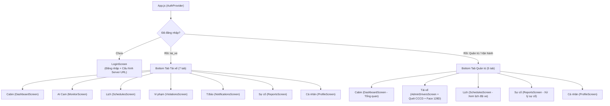

# ĐẶC TẢ THIẾT KẾ UI/UX — ỨNG DỤNG DI ĐỘNG (EXPO SDK 58) — DACN1 V3.0

> **Nền tảng:** React Native / Expo SDK 58 (Android & iOS)
> **Mã nguồn:** `mobile/` (`App.js`, `src/screens/*`, `src/context/AuthContext.js`, `src/config/api.js`)
> **Đối tượng sử dụng:** Tài xế (`tai_xe`) và Nhóm Quản trị/Vận hành (`quan_ly`, `dieu_phoi_vien`, `giam_sat`, `quan_tri_cong_ty`, `admin_he_thong`)
> **Phiên bản:** V3.0 (Đồng bộ toàn bộ nghiệp vụ P0 + P1)

---

## 1. Triết lý thiết kế & Nguyên tắc UX cốt lõi

1. **An toàn giao thông là ưu tiên số 1 (Safety-First UX):**
   - Trong lúc xe đang chạy, ứng dụng **không yêu cầu tài xế thao tác phức tạp** (không bắt nhập biểu mẫu dài). Cảnh báo buồn ngủ sử dụng **âm thanh giọng nói tiếng Việt (`expo-speech`) + rung mạnh (`Vibration`)** để tài xế không phải nhìn vào màn hình.
   - Mọi thao tác kết thúc chuyến, báo cáo sự cố, gửi khiếu nại đều hiển thị nhắc nhở: *"Vui lòng đảm bảo xe đã dừng hẳn ở vị trí an toàn"*.
2. **Dark Cabin Mode (Chống chói khi lái xe ban đêm):**
   - Nền tối sâu `#020617` (Slate 950), thẻ nổi `#0f172a` (Slate 900) viền mảnh `#1e293b` (Slate 800), chữ trắng `#ffffff` / xám sáng `#cbd5e1` giúp giảm mỏi mắt trong cabin tối.
3. **Minh bạch & Công bằng cho tài xế:**
   - Tách bạch hoàn toàn **Cảnh báo AI** (màu xanh dương/vàng, nhãn *"chưa phải vi phạm"*) với **Vi phạm đã xác minh** (màu đỏ/cam, kèm lý do quản lý & nút **Gửi khiếu nại**).
   - Hiển thị rõ ràng **Trạng thái Camera Cabin** ngay màn hình đầu tiên; khi camera `OFFLINE`, banner đỏ khẳng định *"Chuyến đi vẫn tiếp tục ghi nhận (không tự kết thúc)"*.
4. **Thao tác một chạm & Chống bấm nhầm:**
   - Vùng chạm nút tối thiểu `44×44dp`, khoảng cách giữa nút tích cực (Xác nhận) và nút tiêu cực (Từ chối/Kết thúc) rõ ràng bằng màu sắc ngữ nghĩa + hộp thoại xác nhận (`Alert` / `Modal`).

---

## 2. Hệ thống Thiết kế (Mobile Design System)

### 2.1. Bảng màu ngữ nghĩa (Color Tokens)

| Nhóm | Mã Hex | Vai trò sử dụng |
| :--- | :--- | :--- |
| **Background Primary** | `#020617` | Nền toàn màn hình (`container`) |
| **Surface Card** | `#0f172a` | Nền thẻ thông tin, modal, thanh Bottom Tab |
| **Border Subtle** | `#1e293b` / `#334155` | Viền thẻ, viền ô nhập liệu (`TextInput`) |
| **Accent Primary (Cyan)** | `#22d3ee` / `#0891b2` | Tab đang chọn, nút hành động chính, spinner |
| **Success / Online** | `#10b981` / `#059669` | Camera Online, Xác nhận lịch, Chuyến đang chạy |
| **Warning / Appeal** | `#fbbf24` / `#b45309` | Mệt mỏi, Chờ duyệt, Đang khiếu nại, Gửi khiếu nại |
| **Danger / Offline** | `#dc2626` / `#450a0a` | Buồn ngủ, Camera OFFLINE, Từ chối, Kết thúc chuyến |
| **Text Primary / Secondary** | `#ffffff` / `#94a3b8` | Tiêu đề chính / thông tin phụ, nhãn thời gian |

### 2.2. Typography & Spacing
- **Screen Header:** `24–26px`, `fontWeight: "800"`, màu `#ffffff`.
- **Card Title / Big Metric:** `16–22px`, `fontWeight: "700"–"900"`.
- **Body / Meta:** `13px`, `lineHeight: 18–19`, màu `#cbd5e1` / `#94a3b8`.
- **Badge / Tab Label:** `9.5–11px`, `fontWeight: "700"–"800"`, bo tròn `borderRadius: 999`.
- **Bo góc chuẩn:** Card `16–20px`, Button `10–12px`, Input `12px`, Modal `20px`.
- **Padding màn hình:** `18px`, khoảng cách giữa các thẻ `12–14px`.

---

## 3. Kiến trúc Điều hướng (Information Architecture)

---

## 4. Đặc tả chi tiết từng màn hình — Phân hệ TÀI XẾ (`tai_xe`)

### 4.1. Màn hình Đăng nhập (`LoginScreen.js`)
- **Mục đích:** Đăng nhập chung cho cả Tài xế và Quản lý, cấu hình linh hoạt `Server URL` (lưu trong `AsyncStorage`).
- **Thành phần UI:**
  - Logo / Tiêu đề hệ thống DACN1.
  - Ô nhập `Tên đăng nhập`, `Mật khẩu` (ẩn ký tự).
  - Mục mở rộng **Cấu hình Server URL** (ví dụ `http://192.168.1.13:5000`) kèm nút lưu.
  - Nút **Đăng nhập** (`POST /api/login`) có trạng thái loading `ActivityIndicator`.
- **Xử lý lỗi:** Báo rõ *"Sai tài khoản, mật khẩu hoặc tài khoản đã bị khóa"* (`401`) hoặc lỗi mất kết nối mạng.

### 4.2. Tab 1 — Cabin Tài xế (`DashboardScreen.js`)
- **Mục đích:** Màn hình tổng quan tức thì trước và trong chuyến đi (hỗ trợ kéo xuống để làm mới `RefreshControl`).
- **Bố cục từ trên xuống:**
  1. **Header:** *"Cabin Tài xế"* + lời chào `Xin chào, {ho_ten} (Tài xế)`.
  2. **Thẻ Trạng thái Camera Cabin** (`GET /api/driver/camera-status`):
     - `ONLINE_HEALTHY`: Viền xanh ngọc `#0f766e`, chữ xanh `#6ee7b7` *"Đang hoạt động tốt"*, hiển thị `device_id` & `FPS`.
     - `ONLINE_DEGRADED`: Báo *"Tín hiệu suy giảm"*.
     - `OFFLINE`: Nền đỏ sẫm `#450a0a`, viền đỏ `#dc2626`, tiêu đề **"CAMERA MẤT KẾT NỐI"**, nội dung: *"Chuyến đi vẫn tiếp tục ghi nhận (không tự kết thúc). Quản lý đã được thông báo; vui lòng kiểm tra thiết bị khi dừng xe an toàn."*
  3. **Thẻ Xe phụ trách** (`GET /api/driver/dashboard/:id`): Biển số cỡ lớn, tuyến hiện tại, badge trạng thái.
  4. **Thẻ Xác thực khuôn mặt 128D** (`GET /api/driver/face-status/:id`): Trạng thái *Đã đăng ký (N mẫu)* hoặc hướng dẫn liên hệ Quản lý (tài xế không có nút tự đăng ký khuôn mặt).

### 4.3. Tab 2 — AI Camera Dự phòng (`MonitorScreen.js`)
- **Mục đích:** Dùng camera trước điện thoại giám sát buồn ngủ dự phòng khi camera cabin gặp sự cố.
- **Bố cục:**
  - Khung preview Camera (`expo-camera`, camera trước).
  - HUD overlay hiển thị **Fatigue Score (0–100%)**, 4 trạng thái màu sắc (`TINH TAO` xanh lá, `MAT TAP TRUNG` vàng, `MET MOI` cam, `BUON NGU` đỏ), chỉ số `EAR / MAR / Pitch / Yaw` và danh sách lý do phát hiện.
  - Nút **Bắt đầu / Dừng giám sát** & **Reset bộ phân tích** (`/api/ai/analyze-frame`, `/api/ai/reset-monitor`).
- **Phản hồi đa giác quan:** Khi phát hiện `BUON NGU`, tự động rung mạnh + phát giọng nói tiếng Việt qua `expo-speech` + đồng bộ sự kiện về `su_kien_canh_bao` (chờ Quản lý xác minh).

### 4.4. Tab 3 — Lịch chạy & Chuyến đi (`SchedulesScreen.js`)
- **Mục đích:** Toàn bộ vòng đời lịch phân công & chuyến thực tế của tài xế.
- **Bố cục & Tương tác:**
  1. **Banner Chuyến đang chạy** (chỉ hiện khi có `chuyen_thuc_te` trạng thái `DANG_CHAY` từ `GET /api/driver/trips`):
     - Nền xanh lá đậm `#064e3b`, viền `#10b981`, hiển thị mã chuyến, biển số, tuyến đường.
     - Nút đỏ toàn chiều rộng **Kết thúc chuyến đi** → bật `Alert` xác nhận xe đã dừng an toàn → gọi `POST /api/driver/trips/:id/complete`.
  2. **Danh sách thẻ Lịch chạy** (`GET /api/driver/schedules/:id`):
     - Hiển thị: Tên tuyến, Biển số, Giờ bắt đầu, Giờ kết thúc dự kiến, Badge trạng thái (`CHO_XAC_NHAN`, `DA_XAC_NHAN`, `BI_TU_CHOI`, `DANG_THUC_HIEN`, `HOAN_THANH`).
     - **Hành động theo trạng thái:**
       - `CHO_XAC_NHAN` / `sap_chay`: Nút xanh **Xác nhận lịch** (`POST /confirm`) + Nút đỏ **Từ chối** (mở Modal bắt buộc nhập lý do → `POST /reject`) + Nút xám **Đổi lịch/xe**.
       - `DA_XAC_NHAN` / `SAP_CHAY` (khi chưa có chuyến đang chạy): Nút cyan **Bắt đầu chuyến** (`POST /api/driver/trips/start`) + Nút **Đổi lịch/xe**.
  3. **Modal Từ chối / Yêu cầu đổi lịch-xe:**
     - Chọn chip loại yêu cầu (`DOI_THOI_GIAN`, `DOI_XE`, `HUY_LICH`), ô `TextInput` multiline bắt buộc nhập lý do, nút **Đóng** / **Gửi đi**.

### 4.5. Tab 4 — Vi phạm & Khiếu nại (`ViolationsScreen.js`)
- **Mục đích:** Bảo vệ quyền lợi tài xế, tách bạch hoàn toàn cảnh báo AI với vi phạm đã xác minh.
- **Cấu trúc 3 Tab con (Segmented Control):**
  1. **Tab `Vi phạm (N)`** (`GET /api/driver/violations`):
     - Chỉ hiển thị vi phạm đã được Quản lý xác minh từ bảng `vi_pham`.
     - Nội dung thẻ: Loại vi phạm, mã `#id`, badge trạng thái (`HIEU_LUC`, `DANG_KHIEU_NAI`, `DA_HUY_DO_KHIEU_NAI`, `GIU_NGUYEN`), **Lý do xác minh của Quản lý**, thời điểm xác minh.
     - Nút cam **Gửi khiếu nại / Giải trình** (hiện khi `HIEU_LUC` hoặc `GIU_NGUYEN`) → mở Modal nhập giải trình (có dòng lưu ý: *"Nội dung giải trình gốc được lưu bất biến"* → `POST /api/driver/violations/:id/appeals`).
  2. **Tab `Khiếu nại (N)`** (`GET /api/driver/appeals`):
     - Hiển thị mã khiếu nại, mã vi phạm liên kết, trạng thái (`SUBMITTED`, `UNDER_REVIEW`, `NEED_MORE_INFO`, `ACCEPTED`, `REJECTED`), nội dung giải trình gốc, và **Kết luận của Quản lý** (highlight xanh ngọc `#6ee7b7`).
  3. **Tab `Cảnh báo AI (N)`** (`GET /api/driver/ai-events`):
     - Hiển thị các sự kiện AI ghi nhận (`BUON_NGU`, `MAT_TAP_TRUNG`, ...) kèm điểm Risk & trạng thái duyệt, giải thích rõ chưa phải vi phạm.

### 4.6. Tab 5, 6, 7 — Thông báo, Sự cố & Cá nhân
- **Thông báo (`NotificationsScreen.js`):** Danh sách thông báo từ Quản lý & hệ thống (phân công lịch mới, camera offline, xác nhận vi phạm, kết quả khiếu nại), phân biệt chưa đọc/đã đọc.
- **Sự cố (`ReportsScreen.js`):** Form gửi báo cáo sự cố (chọn loại sự cố, tiêu đề, mô tả) + danh sách lịch sử sự cố và phản hồi của Quản lý.
- **Cá nhân (`ProfileScreen.js`):** Thông tin tài khoản, vai trò, đơn vị đội xe, Server URL hiện tại và nút **Đăng xuất** (xóa token + unregister push token).

---

## 5. Đặc tả chi tiết từng màn hình — Phân hệ QUẢN LÝ / VẬN HÀNH

1. **Tab Cabin (`DashboardScreen.js`):** Hiển thị lưới 2 cột gồm 5 thẻ KPI màu sắc (`Tổng tài xế`, `Tổng số xe`, `Xe đang chạy`, `Cảnh báo hôm nay`, `Sự cố chờ xử lý`) + vai trò đang đăng nhập.
2. **Tab Tài xế (`AdminDriversScreen.js` + `FaceRegisterScreen.js`):**
   - Danh sách tài xế kèm số GPLX đã che (`so_gplx_masked`: `079******345`) và trạng thái đăng ký khuôn mặt 128D.
   - Nút **+ Thêm / Quét CCCD**: Mở camera quét mã QR trên CCCD gắn chip Việt Nam, tự động bóc tách Họ tên có dấu, Số CCCD, Địa chỉ → tạo tài khoản → điều hướng thẳng sang `FaceRegisterScreen` chụp 3 góc khuôn mặt để lưu vector 128D.
   - Chỉ Quản lý mới có quyền mở `FaceRegisterScreen`.
3. **Tab Lịch (`SchedulesScreen.js`):** Xem tổng quan lịch chạy trong phạm vi đội xe/chi nhánh.
4. **Tab Sự cố (`ReportsScreen.js`):** Xem danh sách sự cố từ tài xế và bấm 1 chạm **Đánh dấu Đã xử lý** kèm phản hồi.
5. **Tab Cá nhân (`ProfileScreen.js`):** Quản lý phiên đăng nhập và máy chủ kết nối.

---

## 6. Trạng thái UX & Xử lý Ngoại lệ trên Mobile

| Tình huống | Phản hồi giao diện mong đợi |
| :--- | :--- |
| **Đang tải dữ liệu** | Hiển thị `RefreshControl` màu `#22d3ee` hoặc `ActivityIndicator` giữa màn hình. |
| **Danh sách trống** | Hiển thị Empty State căn giữa chữ xám `#64748b` mô tả rõ ngữ cảnh (vd: *"Không có vi phạm nào đã xác minh"*). |
| **Tài khoản bị khóa (`401`)** | Tự động xóa phiên đăng nhập cục bộ và đưa về `LoginScreen`. |
| **Chặn thao tác sai nghiệp vụ (`400`/`409`)** | Hiển thị `Alert.alert` đúng thông điệp từ Backend (vd: *"Tài xế bắt buộc xác nhận lịch trước khi bắt đầu chuyến"* hoặc *"Checklist KHÔNG ĐẠT"*). |
| **Chạy bằng Expo Go Android SDK 53+** | Tự động bỏ qua đăng ký remote push channel mà không làm treo app hay spam lỗi đỏ; remote push kích hoạt đầy đủ khi build `.apk`/`.aab`. |
