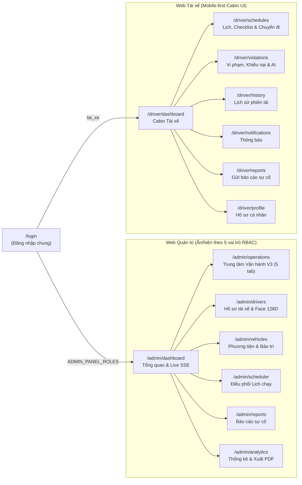

# ĐẶC TẢ THIẾT KẾ UI/UX — ỨNG DỤNG WEB (ADMIN & TÀI XẾ) — DACN1 V3.0

> **Nền tảng:** Flask Jinja2 Templates + Tailwind CSS (CDN) + Vanilla JS Fetch API + Server-Sent Events (SSE)
> **Mã nguồn:** `backend/templates/admin/*`, `backend/templates/driver/*`, `backend/templates/auth/login.html`, `backend/templates/privacy.html`
> **Đối tượng sử dụng:**
> - **Web Quản trị:** 5 vai trò (`admin_he_thong`, `quan_tri_cong_ty`, `quan_ly`, `dieu_phoi_vien`, `giam_sat`)
> - **Web Tài xế:** 1 vai trò (`tai_xe`, giao diện Mobile-first tối ưu cho trình duyệt điện thoại & máy tính bảng)

---

## 1. Hệ thống Thiết kế Chung (Web Design System)

### 1.1. Phong cách & Bảng màu (Tailwind Dark Theme)
Hệ thống dùng giao diện **Dark Slate Operational Theme** đồng nhất giữa Web và Mobile giúp nhân viên giám sát theo dõi màn hình điều hành nhiều giờ không mỏi mắt:

| Thành phần | Class Tailwind chuẩn | Ghi chú sử dụng |
| :--- | :--- | :--- |
| **Nền trang** | `bg-slate-950 text-white min-h-screen` | Toàn bộ trang Admin & Driver |
| **Thanh điều hướng sticky** | `sticky top-0 z-50 bg-slate-950/90 backdrop-blur border-b border-slate-800` | Giữ cố định khi cuộn danh sách dài |
| **Thẻ nội dung (Card)** | `bg-slate-900 border border-slate-800 rounded-3xl p-5 shadow-xl` | Desktop Admin (`rounded-3xl`), Driver (`rounded-2xl`) |
| **Nút chính (Primary)** | `bg-cyan-600 hover:bg-cyan-700 rounded-xl font-bold` | Bắt đầu chuyến, Tab đang chọn, Vận hành V3 |
| **Nút tích cực (Approve)** | `bg-emerald-600 hover:bg-emerald-700` | Xác nhận lịch, Duyệt yêu cầu, Chấp nhận khiếu nại |
| **Nút cảnh báo (Warning)** | `bg-amber-600 hover:bg-amber-700` | Checklist xe, Gửi khiếu nại |
| **Nút nguy hiểm (Danger)** | `bg-red-600 hover:bg-red-700` | Xác minh vi phạm, Từ chối, Kết thúc ngoại lệ, Đăng xuất |
| **Toast phản hồi** | `bg-slate-800 border-cyan-500/40` / `bg-red-950 border-red-500/50` | Tự ẩn sau 5s, hiển thị nguyên văn kết quả từ Backend |

### 1.2. Nguyên tắc Responsive
- **Web Quản trị (`/admin/*`):** Container `max-w-7xl mx-auto`, lưới KPI 1 cột (mobile) → 5 cột (`md:grid-cols-5`), bảng & thẻ tự xếp hàng dọc trên màn hình hẹp.
- **Web Tài xế (`/driver/*`):** Khung Mobile-first `max-w-md mx-auto pb-[110px]` với **Bottom Navigation Bar cố định** 5 mục (`Cabin`, `Lịch`, `Vi phạm`, `Thông báo`, `Cá nhân`) mang lại trải nghiệm giống ứng dụng native ngay trên trình duyệt.

---

## 2. Sơ đồ Luồng Trang & Phân quyền Menu (Sitemap)

### Ma trận hiển thị Menu Web Quản trị theo Vai trò (`lay_menu_theo_vai_tro`)
- **`admin_he_thong` / `quan_tri_cong_ty`:** Đầy đủ mọi trang (bao gồm Tổ chức, Tài khoản, Audit Log).
- **`quan_ly`:** Dashboard, Vận hành V3 (Xác minh AI, Khiếu nại, Chuyến ngoại lệ, Duyệt đổi lịch, Audit Log trong phạm vi), Tài xế, Xe, Lịch chạy, Báo cáo, Thống kê.
- **`dieu_phoi_vien`:** Dashboard, Tài xế (xem), Xe (xem), Lịch chạy (tạo/sửa), Báo cáo (xem). *Bị chặn `403` khi xác minh vi phạm, xử lý khiếu nại, duyệt đổi lịch, hủy lịch hoặc kết thúc ngoại lệ.*
- **`giam_sat`:** Dashboard (realtime, camera health, sự kiện AI), Tài xế (xem), Xe (xem), Báo cáo (xem). *Không có quyền điều phối lịch hay kết luận vi phạm.*

---

## 3. Đặc tả Chi tiết UI/UX — WEB QUẢN TRỊ (`/admin/*`)

### 3.1. Trang Tổng quan & Giám sát Realtime (`/admin/dashboard` — `admin/dashboard.html`)
- **Bố cục:**
  1. **Top Navigation Bar:** Logo `DACN1 Admin` + nút truy cập nổi bật màu cyan **Vận hành V3** (`/admin/operations`) + các mục chính + nút **Đăng xuất**.
  2. **5 Thẻ KPI tổng quan** (auto-refresh 5 giây qua `/api/admin/dashboard`): Tài xế, Xe, Xe đang hoạt động, Cảnh báo hôm nay, Báo cáo chờ xử lý.
  3. **4 Nút thao tác nhanh (Quick Actions):** Quản lý tài xế, Quản lý xe, Lịch chạy, Báo cáo sự cố.
  4. **Bảng Xe đang hoạt động (Live Monitor):** Hiển thị tài xế đang khóa khuôn mặt, biển số, trạng thái AI mới nhất.
  5. **Bảng Trạng thái Thiết bị Camera** (`/api/admin/devices`): Phân loại 3 mức sức khỏe bằng badge màu rõ ràng:
     - 🟢 `ONLINE_HEALTHY` (FPS ≥ 8, không tồn Outbox)
     - 🟡 `ONLINE_DEGRADED` (FPS < 8 hoặc còn sự kiện tồn Outbox / Dead-letter)
     - 🔴 `OFFLINE` (quá 60 giây mất tín hiệu Heartbeat)
  6. **Trung tâm Cảnh báo & Thư viện Ảnh bằng chứng** (`/api/admin/alerts`, `/api/admin/snapshots` dùng Private Signed URL).
  7. **Realtime SSE Toast** (`/api/admin/events`): Tự động bật popup góc dưới bên phải kèm ảnh chụp ngay khi camera biên phát hiện `BUON_NGU`, `NGUOI_LA`, `SAI_XE` hoặc `CAMERA_OFFLINE`.

### 3.2. Trung tâm Vận hành & Kiểm soát V3 (`/admin/operations` — `admin/operations.html`)
Đây là màn hình trung tâm của toàn bộ nghiệp vụ V3.0, hiển thị rõ tên tài khoản & nhãn vai trò (`/api/auth/me`) ngay trên header, chia làm **5 tab độc lập**:

| Tab | API kết nối | Bố cục & Tương tác UX |
| :--- | :--- | :--- |
| **1. Xác minh AI → Vi phạm** | `GET /api/admin/ai-events` `POST .../verify-violation` `POST .../reject` | Lưới 2 cột các thẻ sự kiện AI kèm **ảnh bằng chứng lớn** (`h-44 object-cover`), điểm Risk, trạng thái. Nếu chưa xác minh: hiện 2 nút **Xác minh Vi phạm** (đỏ) & **Bác bỏ / Báo sai** (xám), cả hai đều **bắt buộc nhập lý do** trước khi gửi. Nếu đã xác minh: ẩn nút, hiển thị mã `vi_pham_id` và trạng thái vi phạm. |
| **2. Khiếu nại vi phạm** | `GET /api/admin/appeals` `POST .../decide` | Danh sách thẻ khiếu nại hiển thị mã vi phạm, tên tài xế, trạng thái vi phạm hiện tại, khung tối nổi bật chứa **Giải trình gốc bất biến của tài xế**. Với khiếu nại chưa đóng: hiện 3 nút **Chấp nhận (Hủy vi phạm)**, **Bác bỏ khiếu nại**, **Yêu cầu bổ sung** (bắt buộc nhập lý do kết luận). |
| **3. Chuyến thực tế & Ngoại lệ** | `GET /api/admin/trips` `POST .../force-complete` | Hiển thị từng chuyến thực tế: tuyến, tài xế, xe, giờ bắt đầu, badge trạng thái và **Tổng thời gian Camera Offline (giây)** màu vàng cam. Với chuyến chưa kết thúc: hiện nút đỏ **Kết thúc ngoại lệ** kèm prompt cảnh báo rõ *"không dùng để đối phó lỗi mất kết nối camera"*, bắt buộc nhập lý do. |
| **4. Yêu cầu đổi lịch/xe** | `GET /api/admin/change-requests` `POST .../approve` & `/reject` | Liệt kê yêu cầu (`DOI_THOI_GIAN`, `DOI_XE`, `HUY_LICH`) cùng lý do của tài xế. Với yêu cầu `CHO_DUYET`: nút **Duyệt** (tự kiểm tra lại trùng lịch trong transaction) & **Từ chối** (bắt buộc nhập lý do). |
| **5. Tổ chức & Audit Log** | `GET /api/admin/branches` `GET /api/admin/fleets` `GET /api/admin/audit-logs` | 2 cột hiển thị danh sách **Chi nhánh** & **Đội xe** (kèm số lượng tài xế, xe trực thuộc) + bảng cuộn **Nhật ký kiểm toán bất biến** (thời gian, hành động, bảng/ID, người thực hiện, lý do). |

### 3.3. Các trang Quản trị chuyên biệt khác
- **Tài xế (`/admin/drivers`):** Bảng tài xế hiển thị số GPLX đã che (`so_gplx_masked`), form thêm tài xế (mã hóa `bcrypt`), nút chuyển sang trang đăng ký khuôn mặt 128D (`/admin/drivers/<id>/register-face`).
- **Phương tiện (`/admin/vehicles`):** Thêm/sửa xe, chọn tài xế mặc định; khi chuyển trạng thái sang `bao_tri`/`ngung`, API trả kèm danh sách `affected_schedules` cảnh báo các lịch tương lai bị ảnh hưởng.
- **Lịch chạy (`/admin/scheduler`):** Form phân công lịch mới (tự lọc tài xế `dang_lam` & xe `hoat_dong`), tự động chặn trùng ca (`409 Conflict`), sửa lịch đã xác nhận tự động yêu cầu tài xế xác nhận lại (`CHO_XAC_NHAN`).
- **Báo cáo sự cố (`/admin/reports`):** Tiếp nhận sự cố từ tài xế (bao gồm sự cố tự động sinh ra khi Checklist trước chuyến `KHONG_DAT`) và gửi phản hồi.
- **Thống kê & Xuất PDF (`/admin/analytics`):** Biểu đồ thống kê theo ngày, top tài xế nguy cơ cao, thống kê đa cấp V3 (`/api/admin/analytics/v3`: tỷ lệ khiếu nại được chấp nhận, tổng giây camera offline theo đội xe) và nút **Xuất báo cáo PDF tiếng Việt có dấu** (`/api/admin/export-pdf`).

---

## 4. Đặc tả Chi tiết UI/UX — WEB TÀI XẾ (`/driver/*`)

Thiết kế theo chuẩn **Mobile-First Cabin UI** (`max-w-md mx-auto`) để tài xế mở trên trình duyệt điện thoại hay tablet gắn cabin đều dễ đọc, dễ bấm:

### 4.1. Cabin Tài xế (`/driver/dashboard` — `driver/dashboard.html`)
- Hiển thị thông tin xe phụ trách, tuyến hiện tại, trạng thái làm việc và thẻ lối tắt nhanh sang Lịch trình, Vi phạm, Lịch sử lái, Thông báo, Báo cáo sự cố, Hồ sơ.

### 4.2. Lịch trình, Checklist & Chuyến đi (`/driver/schedules` — `driver/schedules.html`)
- **Bố cục theo trình tự nghiệp vụ trước → trong → sau chuyến:**
  1. **Banner Trạng thái Camera Cabin** (`GET /api/driver/camera-status`):
     - Xanh ngọc khi `ONLINE_HEALTHY` (hiển thị `device_id` & `FPS`).
     - Đỏ rực khi `OFFLINE` kèm thông báo: *"Chuyến đi vẫn tiếp tục ghi nhận (không tự kết thúc). Quản lý đã được thông báo; kiểm tra thiết bị khi dừng xe an toàn."*
  2. **Banner Chuyến đang chạy** (`GET /api/driver/trips`): Xuất hiện nổi bật màu xanh lá đậm khi có chuyến `DANG_CHAY`, kèm nút đỏ **Kết thúc chuyến đi (khi xe đã dừng an toàn)** có hộp thoại xác nhận `confirm()`.
  3. **Danh sách thẻ Lịch chạy:**
     - Lịch `CHO_XAC_NHAN` / `sap_chay`: Nút **Xác nhận lịch**, nút **Từ chối** (bắt buộc nhập lý do), nút **Đổi lịch/xe**.
     - Lịch `DA_XAC_NHAN` / `SAP_CHAY`: Nút vàng cam **Checklist xe** (kiểm tra 6 hạng mục an toàn `LOP_XE`, `PHANH`, `DEN_COI`, `GUONG_CHIEU_HAU`, `GIAY_TO_XE`, `CAMERA_AI`; nếu không đạt tự tạo báo cáo sự cố & chặn khởi hành) + nút cyan **Bắt đầu chuyến** + nút **Đổi lịch/xe**.

### 4.3. Vi phạm & Khiếu nại (`/driver/violations` — `driver/violations.html`)
- **3 Tab độc lập (Grid 3 cột):**
  1. **Tab `Vi phạm`:** Tải `/api/driver/violations` — hiển thị loại vi phạm, trạng thái (`HIEU_LUC`, `DANG_KHIEU_NAI`, `DA_HUY_DO_KHIEU_NAI`, `GIU_NGUYEN`), lý do xác minh, ảnh bằng chứng Signed URL và nút **Gửi khiếu nại / Giải trình** (bắt buộc tối thiểu 5 ký tự).
  2. **Tab `Khiếu nại`:** Tải `/api/driver/appeals` — hiển thị giải trình gốc bất biến và kết luận xử lý từ Quản lý.
  3. **Tab `Cảnh báo AI`:** Tải `/api/driver/ai-events` — hiển thị các cảnh báo an toàn AI riêng biệt, không gán nhãn vi phạm.

### 4.4. Các trang Tài xế còn lại
- **Lịch sử phiên lái (`/driver/history`):** Xem lại các phiên lái xe, thời lượng và lý do đóng phiên (`MANUAL_STOP`, `TRIP_COMPLETED`, `AUTO_MAT_DAU_30P`).
- **Thông báo (`/driver/notifications`):** Xem danh sách thông báo từ Quản lý & hệ thống (sắp xếp mới nhất theo `thoi_gian`), bấm đánh dấu đã đọc (`/driver/read-note/<id>`).
- **Báo cáo sự cố (`/driver/reports`):** Gửi sự cố kèm mô tả và theo dõi phản hồi.
- **Hồ sơ cá nhân (`/driver/profile`):** Cập nhật SĐT, địa chỉ, xem trạng thái khuôn mặt 128D (chỉ xem, không tự sửa khuôn mặt).

---

## 5. Quy tắc Bảo mật & Khả năng tiếp cận (Security & Accessibility UX)

1. **Không tin tưởng giao diện (Zero-Trust UI):** Ẩn nút trên Web chỉ để tối ưu UX; mọi quyền hạn đều được khóa cứng lại bằng `@require_role`, Data Scope và kiểm tra sở hữu tại Backend (trả `401`/`403`/`409`).
2. **Che thông tin nhạy cảm:** Số CCCD/GPLX luôn hiển thị dạng che (`079******345`) trên bảng danh sách; ảnh vi phạm không công khai trực tiếp mà đi qua Signed URL có thời hạn hoặc kiểm tra quyền sở hữu.
3. **Độ tương phản cao:** Chữ trắng `#ffffff` trên nền `#0f172a` đạt tỷ lệ tương phản `> 15:1` (chuẩn WCAG AAA), phù hợp cả phòng điều hành thiếu sáng lẫn cabin xe ban đêm.
4. **Thông báo lỗi rõ ràng bằng tiếng Việt có dấu:** Mọi mã lỗi nghiệp vụ (`400`, `403`, `409`) đều hiển thị nguyên nhân cụ thể giúp người dùng biết chính xác cần làm gì tiếp theo.
